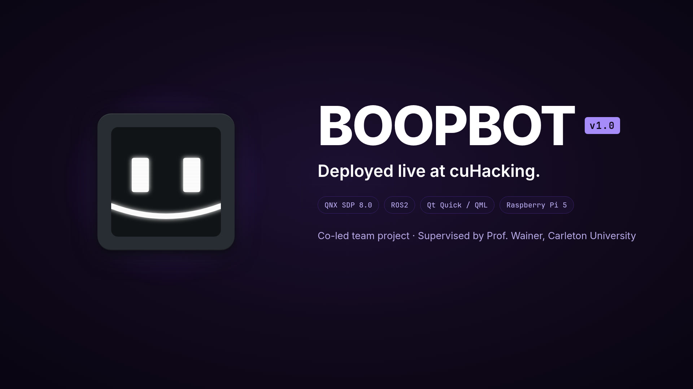
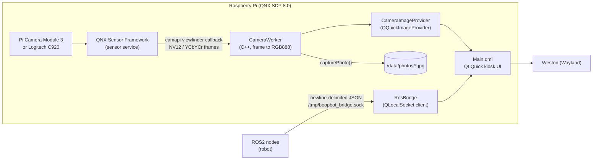

<div align="center">


# BOOPBOT

**A robot photo booth kiosk: native Qt Quick on the QNX real-time OS, running on a Raspberry Pi.**

Live camera feed, 3-2-1 photo capture, a photo wall, and a live robot status panel fed by ROS2.
Built for **cuHacking 2026** (July 10–12, Carleton University).


<a href=".github/assets/boopbot-demo.mp4">
  
</a>

<sub>▶ Click the thumbnail to watch the 20-second demo.</sub>

</div>

---

## What it does

| | |
|---|---|
| 📷 **Live camera feed** | Real-time viewfinder from a Pi Camera Module 3 (CSI) or a Logitech C920 (USB) through the QNX Sensor Framework |
| ⏱️ **Photo booth flow** | Tap **CAPTURE FRAME**, get a 3-2-1 countdown, and the frame is saved as a timestamped JPEG, then shown in a cuHacking 2026 frame |
| 🖼️ **Photo wall** | Browse every photo taken during the event, straight from `/data/photos/` |
| 🤖 **Robot status panel** | Bot state, power, speed and diagnostics streamed live from the robot's ROS2 stack |
| 🛠️ **Hardware status** | Camera status, frame counter and ROS2 connection indicator, so problems show up on the kiosk itself |


## Architecture



**Camera pipeline.** `CameraWorker` opens `CAMERA_UNIT_1` with `camapi` and starts the viewfinder with a C callback. Each frame is converted to RGB888: NV12 for the Pi Camera Module 3, packed YCbYCr 4:2:2 for the C920. The frame is stored behind a mutex, and QML is notified on every 6th frame to keep the UI smooth. QML pulls frames through a `QQuickImageProvider` (`image://camera/...`).

**ROS2 bridge.** `RosBridge` connects to a Unix domain socket at `/tmp/boopbot_bridge.sock` and retries every 2 s if the robot side isn't up yet. It parses one JSON object per line and exposes the values to QML as properties (example values):

```json
{"type": "bot_status",  "value": "ROAMING"}
{"type": "battery",     "value": 87.5}
{"type": "speed",       "value": 0.4}
{"type": "diagnostics", "value": "OK"}
```

The ROS2-side node that publishes to this socket lives with the robot code, not in this repo.

## Supported hardware

| Board | Camera | Status |
|---|---|---|
| Raspberry Pi 4B | Pi Camera Module 3 (imx708, CSI) | ✅ Working |
| Raspberry Pi 4B | Logitech C920 (USB) | ✅ Supported |
| Raspberry Pi 5 | Logitech C920 (USB, blue USB 3.0 port) | ✅ Working with the updated xHCI driver |
| Raspberry Pi 5 | Pi Camera Module 3 (CSI) | 🧪 Experimental |

Software: QNX QSTI build 297 (June 6 2026) or newer, Qt 6.10 via `apk`, and a Weston (Wayland) session on the target.

## Getting started

BOOPBOT builds **natively on the Pi** (no cross-compiling), so you only need SSH access to the target.

```sh
# on the QNX target
git clone https://github.com/anakafeel/QT_BOOPBOT.git boopbot
cd boopbot

./setup.sh   # one time: Qt 6, Sensor Framework, camera drivers, xHCI driver, libyuv
             # (on a Pi 5, reboot after this)
./build.sh   # cmake + make
./run.sh     # pick board + camera, (re)start the sensor service, launch the UI
```

`run.sh` asks which board and camera you are using. It then starts the matching sensor config and sets the Wayland environment (`XDG_RUNTIME_DIR`, `WAYLAND_DISPLAY=wayland-1`, `QT_QPA_PLATFORM=wayland`) before launching `./boopbot`. Fixed per-platform launchers are kept in `backup_scripts/`.

<details>
<summary><b>Manual camera service setup (Pi 4 + Camera Module 3)</b></summary>

```sh
slay sensor 2>/dev/null
sensor -U 521:521 -b external -r /data/share/sensor \
       -c /usr/etc/config/sensor/rpi4_camera_module3.conf &
sleep 3
ls /dev/sensor/     # expect camera1
```
</details>

## Engineering notes: getting a camera working on QNX

Most of this project was platform debugging. The full write-up is in [`docs/qt-qnx-setup-guide-final.md`](docs/qt-qnx-setup-guide-final.md).

- **Two Sensor Framework bugs on Pi 4.** `camera_start_viewfinder` failed with `err=13` (callback IPC permission denied), then crashed in stream cleanup with `err=22`. The fix was flashing QSTI build 297, upgrading to `qnx-sensor-framework` 8.0.4, using the new `rpi4_camera_module3.conf`, and replacing a hand-reconstructed `camera_api.h` with the real SDK headers.
- **Pi 5 USB camera streaming.** The sensor framework requested isochronous alternate setting 10 for 640×480 YUYV, and the Pi 5's DWC3/xHCI USB controller rejected it. This was a driver bug, not a config problem. Installing the updated `qnx-devu-hcd-dwc3-xhci` driver fixed isochronous streaming.
- **Two pixel formats, one UI.** The Pi camera delivers NV12 and the C920 delivers packed YCbYCr, so `CameraWorker` converts both to RGB888 before handing frames to Qt.

## Debugging

```sh
slog2info | grep -i camapi | tail -20     # camera API logs
camera_example3_viewfinder                # check the sensor service without the app
```

- The **CAMERA STATUS** panel shows the live `CameraWorker` status string (for example `camera_open failed: <err>`).
- If Mesa GPU memory errors show up after a crash, reboot the Pi.

## Project layout

```
main.cpp              app entry: wires CameraWorker + RosBridge into QML
camera_provider.*     camapi viewfinder, pixel conversion, photo capture, image provider
ros_bridge.*          Unix-socket JSON client for ROS2 robot status
Main.qml              the kiosk UI (camera, countdown, photo wall, status panels)
setup.sh / build.sh / run.sh
backup_scripts/       fixed launchers per board + camera
docs/                 full QNX + Qt setup and debugging guide
```

## Team

Built at cuHacking 2026 by [Saim Hashmi](https://github.com/anakafeel) and [Naima Mamun](https://github.com/naima-mamun).
